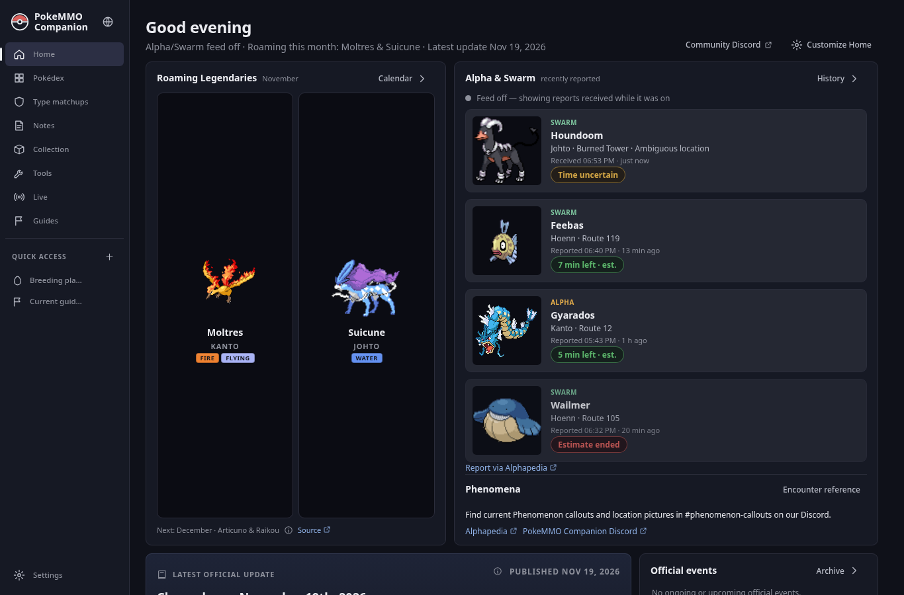
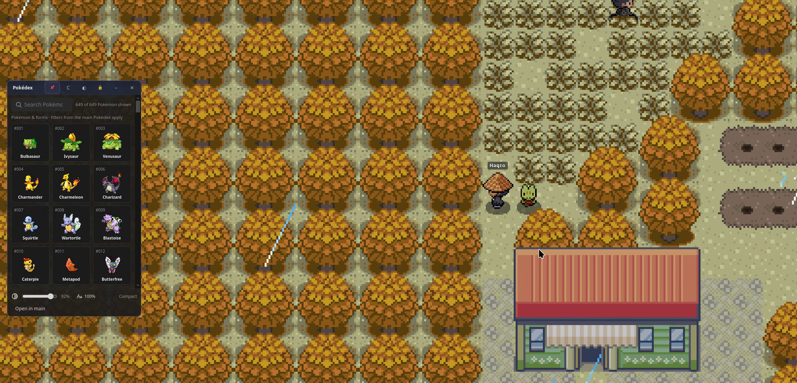
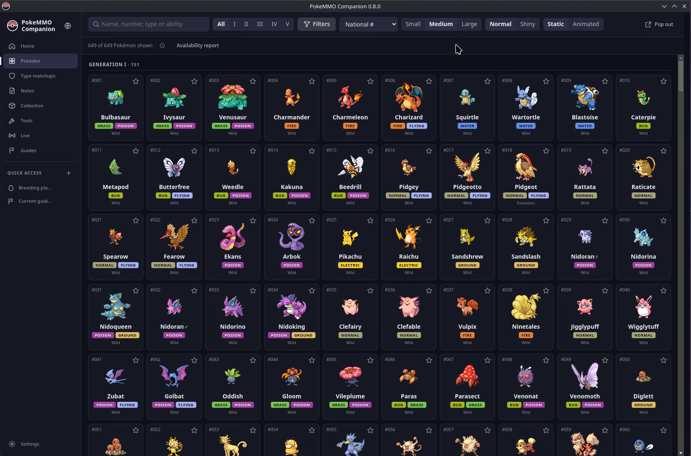
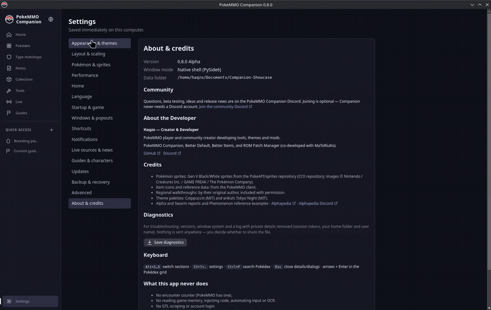
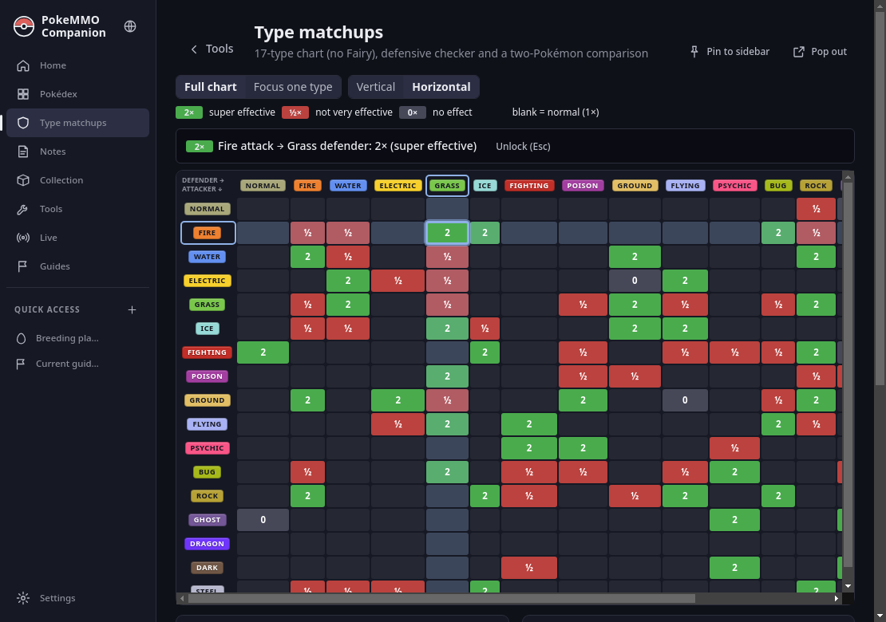
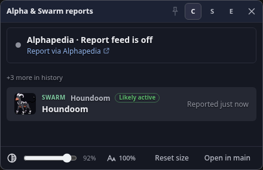

# PokeMMO Companion

An unofficial desktop companion for PokeMMO — Pokémon reference data, regional guides, planning tools and customizable floating windows, all in one application.

**Windows • Linux | English • Español • 简体中文**

[](https://github.com/haqzo/PokeMMO-Companion/releases) [](https://github.com/haqzo/PokeMMO-Companion/releases) [](https://github.com/haqzo/PokeMMO-Companion/stargazers)

[Downloads](https://github.com/haqzo/PokeMMO-Companion/releases) · [Installation](#installation) · [Showcase](showcase/) · [PokeMMO Forums](https://forums.pokemmo.com/index.php?/topic/201960-tools-pokemmo-companion-your-all-in-one-pokemmo-companion-tool-080-alpha/) · [Discord](https://discord.gg/5Wbh28M3gu)

> **v0.8.2 Alpha** · [Release notes and downloads](https://github.com/haqzo/PokeMMO-Companion/releases/tag/v0.8.2).



## Features

- **Pokédex & Location Explorer** — Normal and shiny sprites, Pokémon summaries, advanced filters, over 33,000 encounter records across five regions, and a searchable Item Library.
- **Storyline & Guides** — Five regional walkthroughs, independent character runs, custom guides, progress and timers.
- **Planning tools** — Team Builder, Breeding Planner, Type Matchups, Pokémon comparison, EV and horde planning, catch and stat calculators.
- **Live information** — Optional Alpha and Swarm feeds from [Alphapedia by FlaProGmr and LordDuskk](https://alpha.pokemmotools.org/), with incoming notifications and report history. Use [Report via Alphapedia](https://alpha.pokemmotools.org/help#tab-publish) for manual publishing instructions and Discord sign-in. Also includes an offline Unova Phenomena reference, Legendary rotations, Altering Cave and official news.
- **Personal workspace** — Notes, My Pokémon, Shiny Showcase and reusable timers.
- **Floating windows & customization** — Resizable tools, pinning where supported, opacity, themes, scaling and performance profiles.

The bundled references and most tools work offline. Signed seasonal catalogs are supported for future reference updates. The bundled seasonal catalog is empty. No ROMs, dumps or separate Python installation are required. Reference listings are not a guarantee of current in-game availability.

## Development status & roadmap to 1.0

The current Alpha includes the core tools and is still receiving compatibility and usability feedback.

Our current priorities on the road to 1.0 are:

- **Chat-log integration** — Explore optional, read-only, local processing of PokeMMO's saved logs to improve existing tools and enable reliable progression and gameplay statistics. This is planned work.
- **Stability & performance** — Improve reliability, responsiveness and Windows/Linux compatibility.
- **Tool accuracy & refinement** — Validate reference data, calculations and translations, and improve existing workflows.
- **Community feedback** — Fix reported issues and use real-world testing to guide improvements.

The planned release progression is **0.8.x Alpha → 0.9.x Beta → 1.0 Stable**, with milestones driven by testing and readiness rather than fixed dates. Both successful installations and bug reports are welcome. Interactive Windows testing and broader compatibility feedback are still needed.

## Showcase

The floating Type Chart adjusts the 17-type matrix as you resize, with scrolling when space is tight. It keeps the selected Full Chart or Focus view as you change modes. Home and Live use the same estimated-time indicators. Active encounter sprites and the current roaming Legendaries follow your motion preferences.



| Pokédex | Theme customization |
| --- | --- |
|  |  |

[Explore more screenshots and demonstrations →](showcase/)

| Horizontal Type Chart | Compact Alpha and Swarm window |
| --- | --- |
|  |  |

## Installation

Choose your x86-64 package from [the v0.8.2 release](https://github.com/haqzo/PokeMMO-Companion/releases/tag/v0.8.2).

| Windows x86-64 | Linux x86-64 |
| --- | --- |
| Download the [Windows portable ZIP](https://github.com/haqzo/PokeMMO-Companion/releases/download/v0.8.2/PokeMMO-Companion-0.8.2-windows-x86_64.zip), choose **Extract All**, then open `pokemmo-companion.exe` from the extracted folder. Keep the extracted files together. | Download the [Linux AppImage](https://github.com/haqzo/PokeMMO-Companion/releases/download/v0.8.2/PokeMMO-Companion-0.8.2-x86_64.AppImage), allow it to execute in your file manager, then open it. |

From a Linux terminal, run the following in the download folder.

```bash
chmod +x PokeMMO-Companion-0.8.2-x86_64.AppImage
./PokeMMO-Companion-0.8.2-x86_64.AppImage
```

If FUSE is unavailable, launch with `--appimage-extract-and-run`.

Verify downloaded packages against [SHA256SUMS](https://github.com/haqzo/PokeMMO-Companion/releases/download/v0.8.2/SHA256SUMS) and its [Ed25519 signature](https://github.com/haqzo/PokeMMO-Companion/releases/download/v0.8.2/SHA256SUMS.sig). See the [release notes](docs/releases/0.8.2.md) for tested systems and known limitations. Companion creates a SQLite safety copy before upgrading an older database. Portable ZIP backups and JSON exports exclude local report history. Keep the full profile or a SQLite safety copy to preserve it. Merge keeps your current settings. Replace restores archived settings and supported data. Both modes keep existing local report history.

## Getting started

The optional Welcome panel helps you choose a language and configure PokeMMO integration. Open supported tools using their separate-window icon, then select Compact, Standard or Expanded mode. Themes and performance profiles are available in Settings.

Updates are installed manually. Your personal data is stored separately from the application. Create backups under **Settings → Backup & recovery** before updating.

[User guide, backups and troubleshooting](docs/closed-alpha.md)

## Community

Join the discussion on the [official Companion forum thread](https://forums.pokemmo.com/index.php?/topic/201960-tools-pokemmo-companion-your-all-in-one-pokemmo-companion-tool-080-alpha/) for announcements, questions and community feedback.

This is alpha software. Please report bugs, compatibility problems and translation feedback through [GitHub Issues](https://github.com/haqzo/PokeMMO-Companion/issues) or our [Discord](https://discord.gg/5Wbh28M3gu).

Companion does not read game memory, inject code, automate gameplay, count encounters or collect telemetry. Optional external feeds and update checks require connectivity. The Unova Phenomena reference credits MaToRiuKo and yuisigamy for contributing multilingual field notes.

[Changelog](CHANGELOG.md) · [Credits](CREDITS.md)

PokeMMO Companion is an independent fan-made application and is not affiliated with or endorsed by PokeMMO or its developers.
