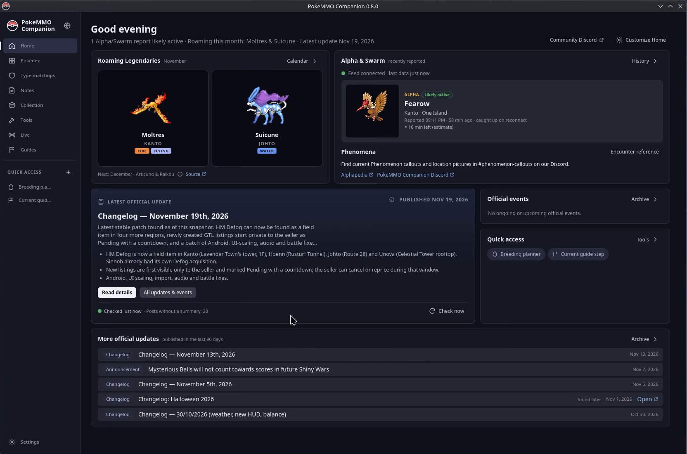

# PokeMMO Companion

An unofficial desktop companion for PokeMMO — Pokémon reference data, regional guides, planning tools and customizable floating windows, all in one application.

**Windows • Linux | English • Español • 简体中文**

[](https://github.com/haqzo/PokeMMO-Companion/releases) [](https://github.com/haqzo/PokeMMO-Companion/releases) [](https://github.com/haqzo/PokeMMO-Companion/stargazers)

[Downloads](https://github.com/haqzo/PokeMMO-Companion/releases) · [Installation](#installation) · [Showcase](showcase/) · [Discord](https://discord.gg/5Wbh28M3gu)

> **0.8.0 Alpha** — Preparing the first public release. Downloads will appear on GitHub Releases after publication.



## Features

- **Pokédex & Location Explorer** — Normal and shiny sprites, Pokémon summaries, advanced filters, over 33,000 encounter records across five regions, and a searchable Item Library.
- **Storyline & Guides** — Five regional walkthroughs, independent character runs, custom guides, progress and timers.
- **Planning tools** — Team Builder, Breeding Planner, Type Matchups, Pokémon comparison, EV and horde planning, catch and stat calculators.
- **Live information** — Optional Alpha and Swarm reports, Legendary rotations, Phenomena, Altering Cave and official news.
- **Personal workspace** — Notes, My Pokémon, Shiny Showcase and reusable timers.
- **Floating windows & customization** — Resizable tools, pinning where supported, opacity, themes, scaling and performance profiles.

The bundled references and most tools work offline. No ROMs, dumps or separate Python installation are required. Reference listings are not a guarantee of current in-game availability.

## Showcase


| Pokédex | Theme customization |
| --- | --- |
|  |  |

[Explore more screenshots and demonstrations →](showcase/)

## Installation

Download the appropriate x86-64 package from [GitHub Releases](https://github.com/haqzo/PokeMMO-Companion/releases).

**Windows — Portable ZIP**

1. Download the Windows ZIP and select **Extract All**.
2. Open the extracted `pokemmo-companion` folder.
3. Run `pokemmo-companion.exe`. Keep all extracted files together.

**Linux — AppImage**

Download the AppImage, allow it to execute in your file manager, and open it. Alternatively, in its download directory:

```bash
chmod +x PokeMMO-Companion-0.8.0-x86_64.AppImage
./PokeMMO-Companion-0.8.0-x86_64.AppImage
```

If FUSE is unavailable, launch with `--appimage-extract-and-run`.

Verify downloaded packages against `SHA256SUMS`. See the release notes for tested systems and known limitations.

## Getting started

The optional Welcome panel helps you choose a language and configure PokeMMO integration. Open supported tools using their separate-window icon, then select Compact, Standard or Expanded mode. Themes and performance profiles are available in Settings.

Updates are installed manually. Your personal data is stored separately from the application. Create backups under **Settings → Backup & recovery** before updating.

[User guide, backups and troubleshooting](docs/closed-alpha.md)

## Community

This is alpha software. Please report bugs, compatibility problems and translation feedback through [GitHub Issues](https://github.com/haqzo/PokeMMO-Companion/issues) or our [Discord](https://discord.gg/5Wbh28M3gu).

Companion does not read game memory, inject code, automate gameplay, count encounters or collect telemetry. Online reports, news and update checks require connectivity.

[Changelog](CHANGELOG.md) · [Credits](CREDITS.md)

PokeMMO Companion is an independent fan-made application and is not affiliated with or endorsed by PokeMMO or its developers.
