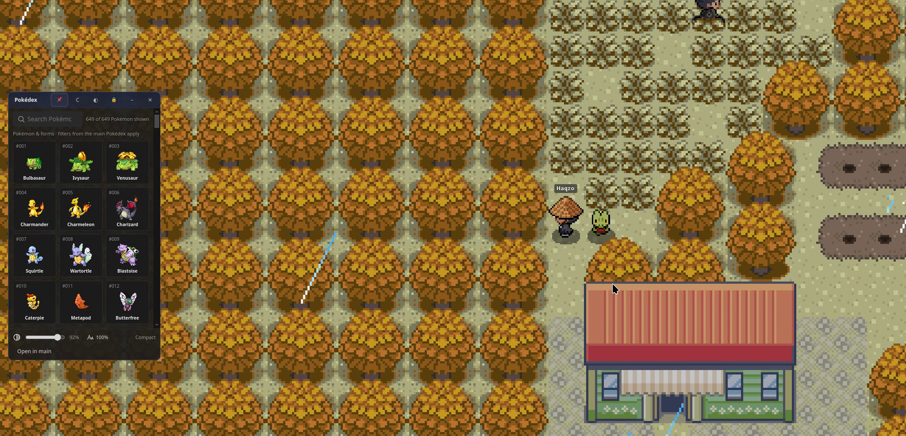
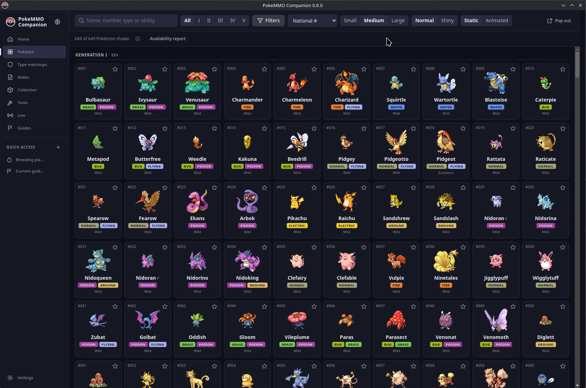
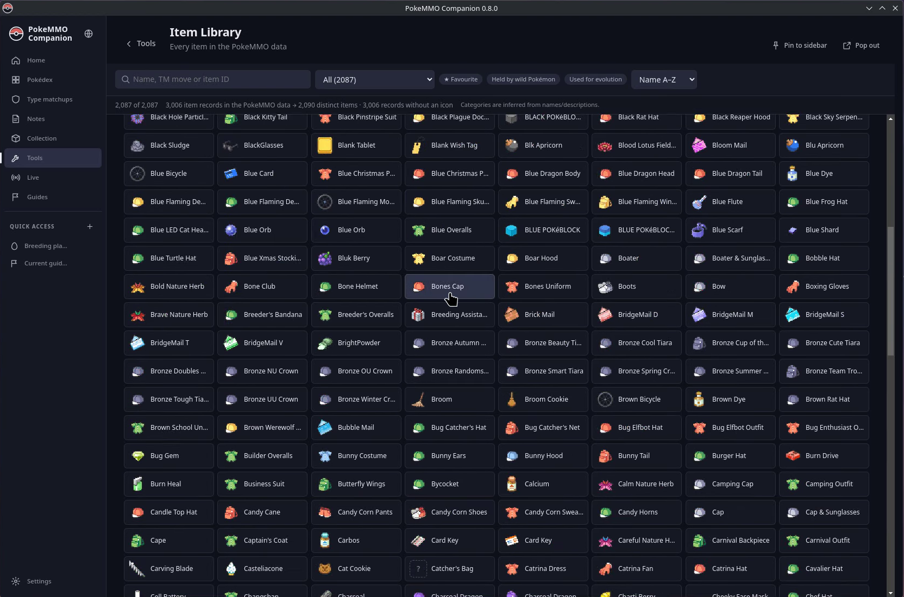
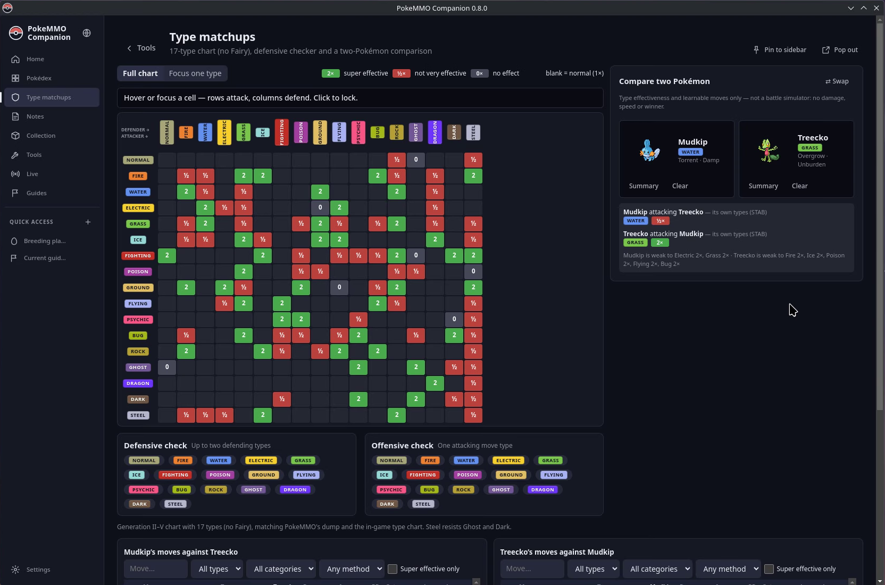
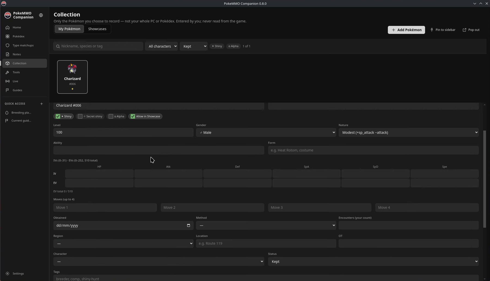
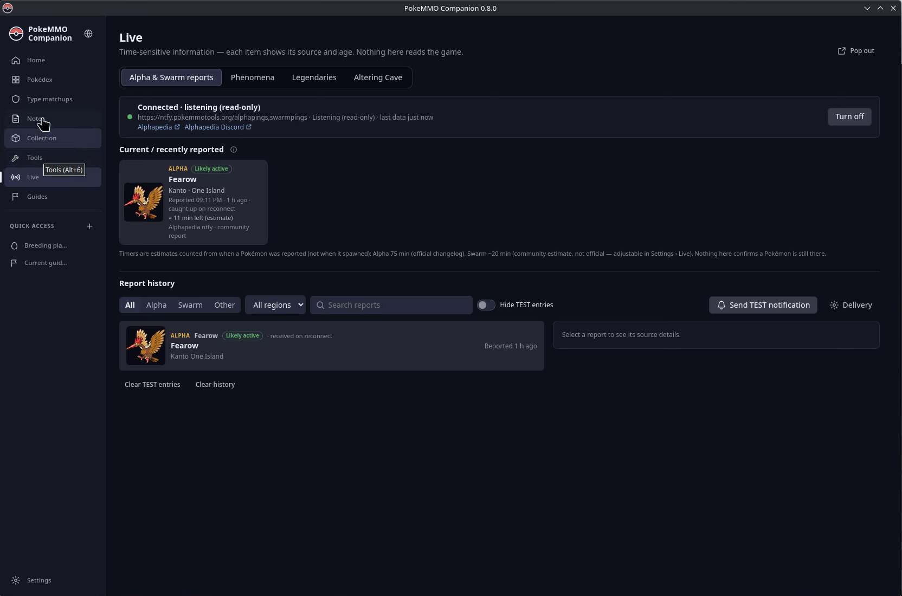
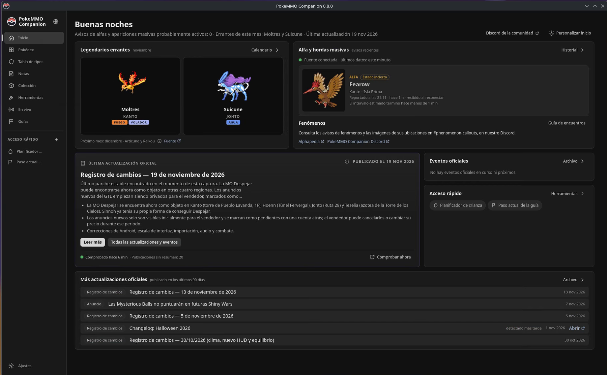
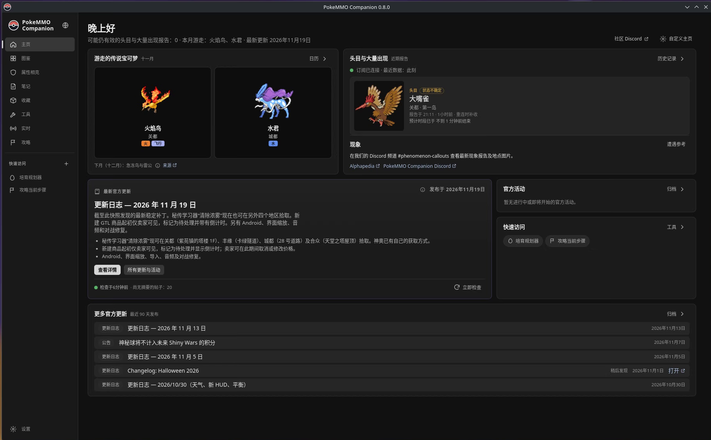
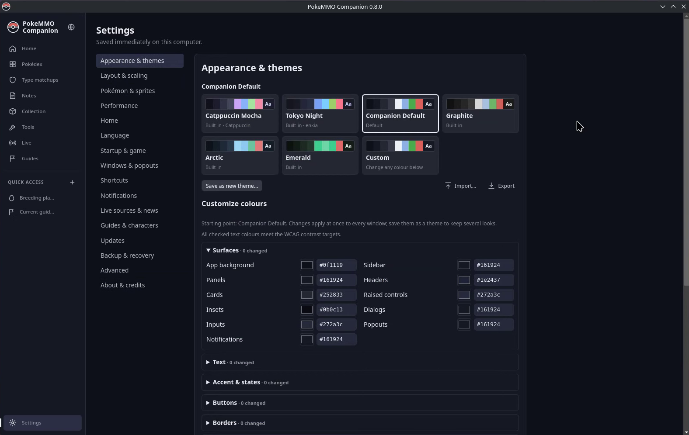

# PokeMMO Companion — Showcase

Real captures of the 0.8.0 Alpha interface. The gameplay image shows a floating Companion window alongside PokeMMO; the captured game is not part of Companion. Live reports and news reflect the time of recording.

## Overview

| Dashboard | Floating Pokédex |
| --- | --- |
|  |  |

## Explore and plan

| Pokédex | Pokémon summary |
| --- | --- |
|  |  |
| Location Explorer | Item Library |
|  |  |
| Regional walkthrough | Type comparison |
|  |  |

## Personal tools and reports

| My Pokémon | Shiny Showcase |
| --- | --- |
|  |  |
| Live reports | Shiny sprites |
|  |  |

## Customization and languages

| Emerald | Graphite |
| --- | --- |
|  |  |
| Spanish | Simplified Chinese |
|  |  |
| Appearance settings | Performance settings |
|  |  |

## Short demonstrations

| Animated Pokédex | Themes |
| --- | --- |
|  |  |

MP4 clips (open or download): [Floating tools](videos/floating-tools.mp4) · [Locations](videos/locations.mp4) · [Pokédex](videos/pokedex.mp4) · [Shiny sprites](videos/shiny-sprites.mp4) · [Showcase](videos/showcase.mp4) · [Themes](videos/themes.mp4) · [Languages](videos/languages.mp4).

[Return to the project](../README.md)
